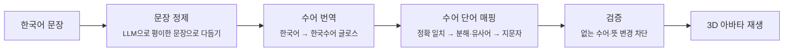

# Signmate

### 읽는 문장에서, 보는 언어로

웹페이지의 한국어 문장을 3D 아바타가 **한국수어**로 보여주는 서비스입니다. 
읽던 화면에서 문장을 드래그하면 페이지 옆에 아바타가 나타나 수어로 표현합니다.

 

<!-- 시연 GIF가 준비되면 아래 주석을 풀고 경로를 바꿔주세요 -->
<!--    -->

 

## 👋 팀 소개

<table>
  <tr>
    <td align="center" width="25%">
      <a href="https://github.com/garden0324"> <b>임정원</b></a> 
      팀장 · 아바타 &amp; 앱
    </td>
    <td align="center" width="25%">
      <a href="https://github.com/YOOhyerin"> <b>윤혜린</b></a> 
      백엔드
    </td>
    <td align="center" width="25%">
      <a href="https://github.com/azeroo0"> <b>윤아영</b></a> 
      프론트엔드
    </td>
    <td align="center" width="25%">
      <a href="https://github.com/dlgusxor12"> <b>이현택</b></a> 
      AI 에이전트
    </td>
  </tr>
  <tr>
    <td valign="top">수어 영상의 동작을 3D 아바타로 옮기는 리타게팅 파이프라인과 수어 DB를 구축하고, Android 앱을 개발</td>
    <td valign="top">Spring 기반 서버를 설계·개발하고, 회원 인증과 구독 결제를 연동</td>
    <td valign="top">크롬 익스텐션 사이드바와 웹사이트를 개발하고, 로그인부터 수어 변환, Pro 구독·결제까지 사용자가 만나는 화면을 담당</td>
    <td valign="top">한국어 문장을 한국수어 어순으로 바꾸고 수어 단어와 연결하는 번역 에이전트를 설계·개발</td>
  </tr>
</table>

 

## 💡 왜 만들었나요

수어를 사용하는 농인의 **90.8%** 가 가장 적절한 언어로 한국수어를 꼽았고, 한글(문자언어)이라고 답한 비율은 **3.5%** 에 그쳤습니다.[1]

농인에게 한국어 텍스트는 제2언어에 가깝습니다. 자막과 문자로만 제공되는 디지털 정보는 그 자체로 장벽이 됩니다.
Signmate는 웹의 텍스트를 농인의 제1언어인 한국수어로 보여주어, 누구의 도움 없이도 필요한 정보를 바로 이해할 수 있는 환경을 만듭니다.

[1] 국립국어원, 「<a href="https://korean.go.kr/front/reportData/reportDataView.do?report_seq=1172">2023년 한국수어 활용 조사 결과 분석 연구</a>」, 2024.

 

## ✨ 주요 기능

| 기능 | 설명 |
|---|---|
| 🖱️ **드래그해서 수어로 보기** | 웹페이지에서 문장을 드래그하면 페이지 옆에 아바타가 나타나 한국수어로 표현합니다. |
| 🔄 **손 모양 자세히 보기** | 아바타를 회전하고 확대해서 손 모양과 방향을 확인할 수 있습니다. |
| 🪟 **플로팅 카드** | 보던 페이지를 벗어나지 않고 그 자리에서 수어를 확인합니다. |
| 🔐 **간편 로그인** | 이메일, 카카오, 구글 계정으로 로그인합니다. |
| 💳 **무료 / Pro** | 무료 플랜은 하루 30회, Pro 구독은 제한 없이 이용할 수 있습니다. |

 

## ⚙️ 어떻게 동작하나요

한국수어는 한국어와 어순과 문법이 다른 별도의 언어입니다. 그래서 단어를 1:1로 바꾸는 대신, 문장을 **번역**한 뒤 수어 단어와 연결합니다.

- **매핑 에이전트**: DB에서 정확히 일치하는 수어를 먼저 찾고, 없으면 말을 나누거나 비슷한 표현을 찾고, 그래도 없으면 지문자로 표현합니다.
- **설계 원칙**: *"읽기 불편한 것보다 틀린 것이 더 나쁘다."* LLM이 존재하지 않는 수어를 만들거나 원문에 없는 뜻으로 바꾸면, 검증 단계에서 막고 지문자로 대체합니다.
- **3D 아바타**: 수어 영상에서 관절 좌표를 뽑아 아바타의 뼈 회전값으로 옮기고, 동작과 동작 사이를 자연스럽게 이어 문장 단위로 재생합니다.

 

## 🛠️ 기술 스택

| 영역 | 기술 |
|---|---|
| **AI / 번역** |      |
| **백엔드** |  |
| **프론트엔드** |  |
| **앱** |  |
| **데이터** |  |

 

## 🔗 링크 · 문의

| | |
|---|---|
| 🌐 웹사이트 | [sign-mates.com](https://sign-mates.com/) |
| 🧩 크롬 익스텐션 | [Chrome 웹스토어](https://chromewebstore.google.com/detail/signmate/focaoflmjddjlionmmcpblmhopdfocho) |
| ▶️ 유튜브 | [@sign-mates](https://www.youtube.com/@sign-mates) |
| 📷 인스타그램 | [@_signmate](https://www.instagram.com/_signmate/) |
| ✉️ 문의 | hyeongapyear26@gmail.com |

 
© 2026 Signmate. 읽는 문장에서 보는 언어로.

